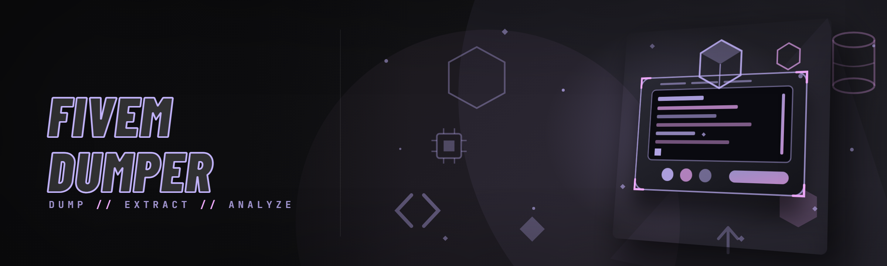

  
  
  

  

  
  

---

FiveM asset dumper: extracts server resources, streamed YTD/YDR models, ymap/meta files and RPFs to disk, plus cache decrypt and hash-to-name lookup.

## Overview

FiveM asset dumper: extracts server resources, streamed YTD/YDR models, ymap/meta files and RPFs to disk, plus cache decrypt and hash-to-name lookup.

  

## License

[MIT License](LICENSE)

  

